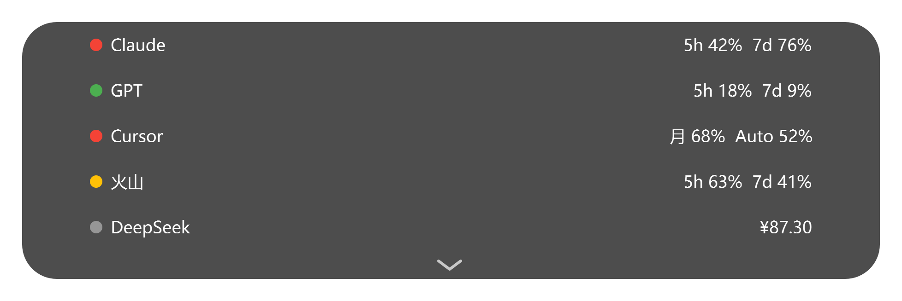
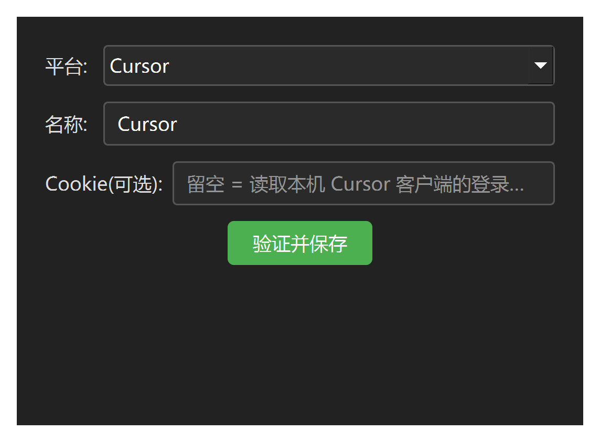
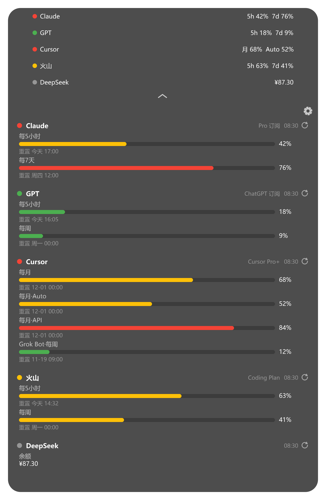
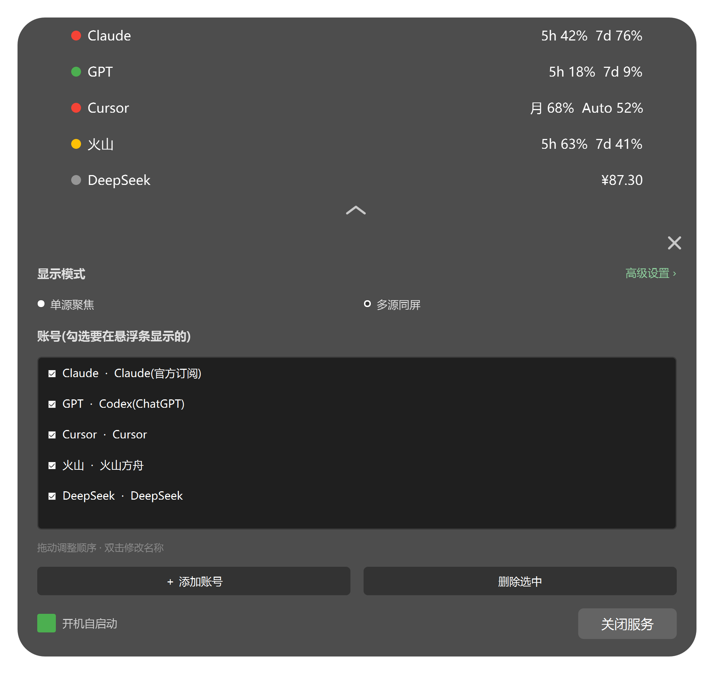
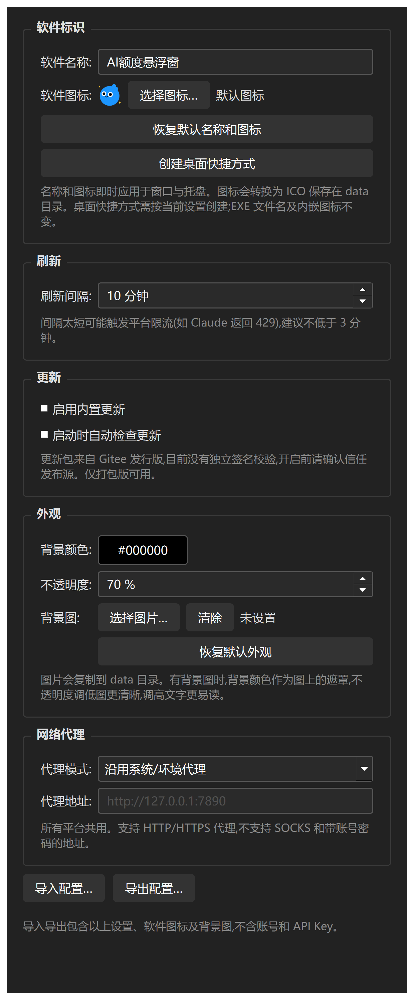

# AI 额度悬浮窗

在桌面查看 Claude、Codex（ChatGPT）、Cursor、火山方舟等平台的额度、重置时间和钱包余额。基于 Python / PySide6，主要面向 Windows。

支持单源聚焦、多源同屏、贴边收起、多账号管理，以及名称、图标、背景和代理配置。

本项目基于原作者的 [AI 额度悬浮窗（wang-guanru/ai-limit-monitoring）](https://gitee.com/wang-guanru/ai-limit-monitoring) 继续开发，感谢原作者的工作。



> 截图由当前 UI 使用模拟数据生成，不含真实账号或密钥。各平台接口可能变化，额度以官方控制台为准。本仓库源码包含近期改动；上游 Gitee 安装包不代表当前版本。

## 最近更新

- **Cursor**：可读取本机客户端登录状态，也可手填会话 Cookie；展示月度套餐、Auto / API、按量付费和符合条件的 Grok Bot 周额度。统一套餐按共用周额度展示。
- **账号管理**：拖拽调整顺序，双击修改名称，勾选悬浮条中要显示的账号。每个账号可单独刷新，并显示最近获取数据的时间。
- **窗口与外观**：可拖拽调整窗口宽度和详情面板高度；支持背景颜色、不透明度、背景图、自定义软件名称和图标，以及创建桌面快捷方式。
- **配置迁移**：一个 TOML 文件导入 / 导出设置、代理、图标和背景图，不包含账号和密钥。
- **网络与隐私**：所有平台共用一个代理配置；限制平台请求的 HTTPS 主机，隔离账号会话，日志脱敏，内置更新默认关闭。

## 开始使用

### 从源码启动

需要 Python 3.11 或更新版本。在项目根目录执行：

```powershell
py -3 -m venv .venv
.\.venv\Scripts\python.exe -m pip install -r requirements.txt
.\.venv\Scripts\python.exe main.py
```

首次启动会进入账号管理页。点击 **添加账号**，选择平台，填写名称和必要凭据，验证成功后保存。CLI 登录类平台和 Cursor 本机登录模式不需要手填 API Key。

### 使用 Windows 打包版

如使用根据当前源码构建的 ZIP，解压整个文件夹，再双击 `AI额度悬浮窗.exe`。请保留同目录下的 `_internal` 文件夹。用户数据保存在 EXE 同级的 `data/` 中，程序目录需要可写。

当前不提供与本次源码核验对应的 GitHub Release 下载链接。自行构建见 [开发与打包](docs/development.md)。不要将旧版安装包当作本版分发。

## 支持的平台

当前添加账号列表提供 **17 个适配项**，其中 GLM 的个人、国际和团队版分别计数。

| 平台 | 凭据来源 | 主要显示内容 |
| --- | --- | --- |
| Claude（官方订阅） | Claude Code 本地登录文件 | 5 小时、7 天等窗口额度 |
| Codex（ChatGPT） | Codex CLI 的 ChatGPT 登录文件 | 套餐额度、重置时间 |
| Cursor | 本机 Cursor 登录状态，或手填 Cookie | 月度套餐、Auto / API、按量付费、Grok Bot |
| Gemini（官方） | Gemini CLI 本地 OAuth 登录文件 | 按模型分组的额度 |
| Grok（xAI） | Grok CLI 本地登录文件 | 当前周期额度 |
| GitHub Copilot | GitHub Token | 高级请求剩余次数 |
| GLM（智谱）、GLM 国际版（z.ai）、GLM 团队版 | API Key；团队版另需组织和项目 ID | 套餐窗口额度 |
| Kimi、MiniMax | API Key | Coding Plan 额度 |
| 火山方舟 | Access Key ID / Secret Access Key | Agent / Coding Plan 额度 |
| DeepSeek、StepFun、硅基流动、OpenRouter、Novita AI | API Key | 钱包余额 |

ZenMux 和自定义额度查询地址已停用。API 钱包余额与订阅额度是不同的数据，普通推理 API Key 也不一定能查询订阅套餐。

### 添加 Cursor

1. 先在本机 Cursor 客户端登录。
2. 打开本工具的 **设置 → 添加账号**，选择 **Cursor**。
3. 填写名称，将 **Cookie（可选）** 留空，点击验证并保存。



Windows 下默认从 `%APPDATA%\Cursor\User\globalStorage\state.vscdb` 只读获取当前登录状态。本工具不会替 Cursor 续期；过期后请在 Cursor 重新登录，再刷新本工具。

如无法读取本机状态，可填写 Cursor 网页会话的 `WorkosCursorSessionToken` 值，或包含该字段的 Cookie 请求头。Cookie 相当于登录凭据，请勿分享、截图或提交到仓库。手填 Cookie 保存在系统凭据库。多个留空 Cookie 的 Cursor 条目都读取同一个本机登录；监控不同账号需分别提供对应 Cookie。

只有接口实际返回的档位才会显示；部分套餐没有 Auto / API 或 Grok Bot 档位。Grok Bot 附加接口失败时，仍保留 Cursor 主额度。

## 日常操作

### 查看和刷新额度

点击悬浮条底部的箭头展开详情，查看进度条、余额、重置时间和数据时间；再次点击箭头收起。百分比表示**已用额度**，钱包类显示剩余金额。圆点绿色表示用量较低，黄色表示偏高，红色表示告急，灰色通常表示没有百分比档位或没有可用数据。



- 点击账号右侧的刷新图标，仅刷新该账号；托盘菜单也提供整体刷新。
- 默认每 **10 分钟**自动刷新。高级设置可设为 1～120 分钟，建议不低于 3 分钟，以减少平台限流。
- 网络错误或 HTTP 429 限流时会保留上次有效数据，因此请结合数据时间判断是否为最新值。
- 将窗口拖到屏幕边缘可贴边收起，拖回桌面恢复。拖拽窗口左右边缘调整宽度，详情页底边调整面板高度。

### 管理账号

点击齿轮进入设置页：**单源聚焦**显示所选账号，**多源同屏**显示已勾选账号。拖拽列表可调整顺序，双击名称可重命名；删除选中账号会同时尝试清理本工具保存的凭据，不会退出对应 CLI 或 Cursor。



设置页可切换开机自启，也可从系统托盘操作；**关闭服务**会退出程序。

### 调整高级设置

进入 **设置 → 高级设置**，修改后自动保存并生效，底部会显示结果，无需再点“确定”。

- **软件标识**：修改窗口和托盘的名称、图标，或按当前设置创建桌面快捷方式。修改后不自动更新已有快捷方式，也不改写 EXE 文件名及其内嵌图标。
- **外观**：选择背景颜色、不透明度和背景图。有背景图时，颜色作为遮罩；提高不透明度可以增强文字对比度。
- **刷新与更新**：调整刷新间隔。内置更新和启动更新检查默认关闭；现有更新源仍是上游 Gitee，并未迁移到 GitHub。启用前请核对来源，更新包目前没有独立签名验证。
- **网络代理**：所有平台共用设置，界面修改后从下一次刷新起生效。



## 配置导入与导出

1. 在 **高级设置**底部点击 **导出配置…**，保存为 TOML 文件。
2. 在另一份程序中打开 **高级设置 → 导入配置…**，选择该文件。
3. 确认底部显示“已导入并生效”，再按需重新添加账号和开启自启。

| 包含 | 不包含 |
| --- | --- |
| 软件名称、图标、刷新间隔、更新开关 | 账号列表、账号名称、API Key、Cookie、Token |
| 背景颜色、不透明度、背景图 | CLI / Cursor 登录文件、运行日志 |
| 统一代理的模式和地址 | 开机自启、窗口位置与大小、账号勾选和排序 |

图标和背景图以 Base64 内嵌到 TOML，导入时还原到 `data/`，无需另带图片。Base64 不是加密；导出文件仍可能暴露自定义名称、图片内容及代理地址，分享前请检查。配置文件最大 30 MB，单张图片最大 10 MB、4096×4096 像素。也兼容没有内嵌图片的旧 TOML 文件。Gemini OAuth 客户端配置属于本机配置，不参与导入导出。

### 代理配置

推荐通过高级设置修改代理。也可编辑首次启动生成的 `data/proxy.toml`，手工修改文件后需重启：

```toml
[proxy]
mode = "custom"
url = "http://127.0.0.1:7890"
```

`7890` 是示例 HTTP / 混合代理端口，请替换为自己的端口。

| 模式 | 行为 |
| --- | --- |
| `environment`（默认） | 沿用 Requests 可读取的系统 / 环境代理，包括 `HTTPS_PROXY`、`HTTP_PROXY`、`ALL_PROXY`、`NO_PROXY`；无代理时可能直连。 |
| `custom` | 所有平台使用指定 HTTP / HTTPS 代理，忽略系统 / 环境代理与 `NO_PROXY`；失败不自动回退直连。 |
| `direct` | 所有平台直连，忽略系统 / 环境代理。 |

`environment` 和 `direct` 模式的 `url` 应为空。自定义代理不支持 SOCKS、用户名密码、路径、查询参数或按平台分别配置；无效配置不会静默改为直连。本工具不修改 Windows 全局代理，也不读取 CLI 专属代理设置。

## 数据与隐私

- 手填密钥和 Cookie 存入系统凭据库；`data/accounts.json` 保存账号标签、平台、启用状态及非秘密字段（例如组织 / 项目 ID）。这些信息也可能涉及隐私，**不要分享整个 `data/`**。
- Claude、Codex、Gemini、Grok 读取各自本地 CLI 登录文件，Cursor 读取本机登录数据库。凭据用于直接访问相应平台，Gemini 还会进行 OAuth 刷新；本工具不会运行 CLI 来代发请求。
- 平台请求限制为指定 HTTPS 主机，禁止重定向，按账号隔离会话。日志有脱敏处理，但不能保证识别任意形式的秘密，请先检查日志再反馈问题。
- 分享文件或反馈问题前，请先检查账号信息、图片和日志。凭据来源、代理和更新行为见 [安全与隐私说明](SECURITY.md)。

## 常见问题

**没有找到 CLI 登录状态？** 先用对应 CLI 登录。Claude 读取 `~/.claude/.credentials.json`，Codex 读取 `~/.codex/auth.json` 中的 ChatGPT 登录，Gemini 读取 `~/.gemini/oauth_creds.json`，Grok 读取 `~/.grok/auth.json`。仅保存到其他位置或系统凭据库的 CLI 登录状态可能无法读取。

**Gemini 提示配置 OAuth 客户端？** 有效的 CLI 访问 Token 可直接使用。需要本工具刷新过期 Token 时，在程序目录的 `data/gemini-oauth.toml` 填写与 Gemini CLI 登录所用客户端一致的参数：

```toml
[oauth]
client_id = "填入对应的客户端 ID"
client_secret = "填入对应的客户端 secret"
```

Gemini CLI 的客户端参数可在其 [官方 OAuth 实现](https://github.com/google-gemini/gemini-cli/blob/main/packages/core/src/code_assist/oauth2.ts) 中核对 `OAUTH_CLIENT_ID` / `OAUTH_CLIENT_SECRET`。配置文件不提交、不打包，也不导出；不要填写用户的访问或刷新 Token。也可先用 Gemini CLI 重新登录，再回到本工具刷新。缺少或无效配置时，本工具会提示，不会发送刷新请求。

**出现 401 / 403 或 Cursor 登录过期？** 在对应客户端重新登录，或重新添加有效凭据。反复点击刷新不能恢复失效凭据。

**出现 429 或数据没有变化？** 延长刷新间隔，稍后再试，并检查数据时间、代理和官方控制台。界面保留旧值不代表刚刚刷新成功。

**导入配置后没有账号？** 这是预期行为。导入 / 导出只迁移设置和图片，账号需要重新添加。

**源码启动后看不到窗口？** 如此前运行过离屏测试，在同一个终端启动前执行 `Remove-Item Env:QT_QPA_PLATFORM -ErrorAction SilentlyContinue`，并检查系统托盘。

开发、测试、截图生成和 Windows 构建方法见 [开发与打包](docs/development.md)。
